<div align="center">

# 🔐 Laboratorio #2 – Implementación del Login en Laravel

### Unidad I: Modelo Vista Controlador (MVC)

**Universidad Tecnológica de Panamá**
Facultad de Ingeniería en Sistemas Computacionales · Campus Víctor Levis Sasso
Desarrollo Web


</div>

---

## 📑 Contenido

1. [Introducción y objetivo](#1--introducción-y-objetivo)
2. [Requisitos previos](#2--requisitos-previos)
3. [Instalación y flujo de comandos](#3--instalación-y-flujo-de-comandos)
4. [Base de datos](#4--base-de-datos)
5. [Resultado del laboratorio](#5--resultado-del-laboratorio)
6. [Arquitectura MVC en el proyecto](#6--arquitectura-mvc-en-el-proyecto)
7. [Dificultades y soluciones](#7--dificultades-y-soluciones)
8. [Fechas](#8--fechas)
9. [Referencias](#9--referencias)

---

## 1. 📘 Introducción y objetivo

Este laboratorio es un primer acercamiento al framework **Laravel** y a su estructura de trabajo. Laravel se basa en el patrón **Modelo–Vista–Controlador (MVC)**, que separa las responsabilidades de la aplicación para facilitar el mantenimiento y la reutilización del código.

**Objetivo:** identificar la estructura básica de un proyecto Laravel, comprender cómo se organiza bajo el patrón MVC e implementar un módulo de **login y registro de usuarios** con el paquete `laravel/ui` y Bootstrap.

### Función de las principales carpetas (MVC)

| Parte del MVC | Carpeta / archivo | ¿Qué hace? |
|---|---|---|
| 🗂️ **Modelo** | `app/Models/` | Representa las tablas de la base de datos y permite consultarlas (ej. `User.php`). |
| 🖼️ **Vista** | `resources/views/` | Plantillas Blade con lo que ve el usuario (ej. `auth/login.blade.php`). |
| 🧠 **Controlador** | `app/Http/Controllers/` | Recibe la petición, aplica la lógica y devuelve una vista (ej. `LoginController`). |
| 🧭 **Rutas** | `routes/web.php` | Conecta cada URL con su controlador. |
| 🧱 **Migraciones** | `database/migrations/` | Describen la estructura de las tablas en código PHP. |
| ⚙️ **Configuración** | `.env` y `config/` | Credenciales de la base de datos y parámetros de la aplicación. |

**Flujo de una petición:** el usuario entra a `/login` → la **ruta** apunta al **controlador** → el controlador usa el **modelo** `User` para consultar la base de datos → devuelve la **vista** `login.blade.php`.

---

## 2. 🧰 Requisitos previos

### Ecosistema de desarrollo

| Tecnología | Detalle | Versión utilizada |
|---|---|---|
|  | **Sistema operativo** | Windows (64 bits) |
|  | **Entorno de desarrollo local** (servidor web Apache + MySQL) | WampServer 64 bits |
|  | Lenguaje del backend (con variables de entorno configuradas) | 8.4.15 |
|  | Gestor de dependencias de PHP | 2.10.3 |
|  | Instalador de Laravel (`laravel new`) | 5.32.0 |
|  | Base de datos (motor InnoDB) | 8.4.7 |
|  | Necesario para compilar los assets con Vite | 24.21.0 |
|  | Gestor de paquetes de Node | 11.19.0 |
|  | Editor de código | Visual Studio Code |
|  | Administración de la base de datos | Incluido en WAMP |

> **Nota:** WampServer debe tener el ícono **verde** (Apache y MySQL en ejecución) antes de empezar.

### Verificación de versiones

```bash
php -v
composer -V
node -v
npm -v
```

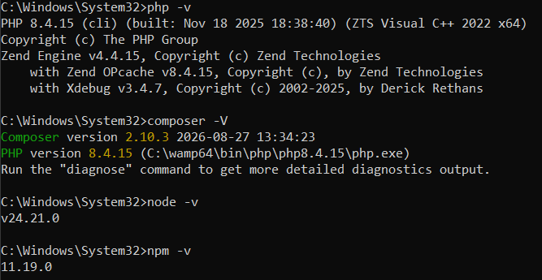

### Motor de almacenamiento InnoDB

Se configuró `default-storage-engine=InnoDB` en el `my.ini` de MySQL y se verificó en phpMyAdmin:

```sql
SHOW VARIABLES LIKE 'default_storage_engine';
```

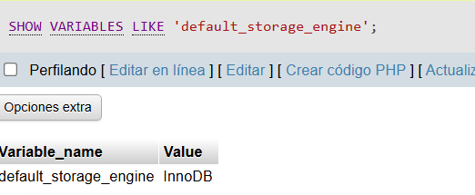

### Instalador de Laravel

```bash
composer global require laravel/installer
laravel --version
```

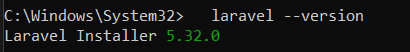

---

## 3. 💻 Instalación y flujo de comandos

### 3.1 Crear el proyecto (dentro de `C:\wamp64\www`)

```bash
cd C:\wamp64\www
laravel new PruebaRegistroLaravel
cd PruebaRegistroLaravel
```

Respuestas del instalador: **starter kit = no**, **frontend stack = Blade**.

> Alternativa sin el instalador: `composer create-project laravel/laravel PruebaRegistroLaravel`

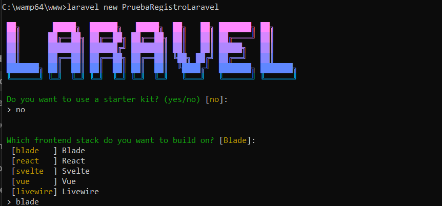

Estructura inicial del proyecto:

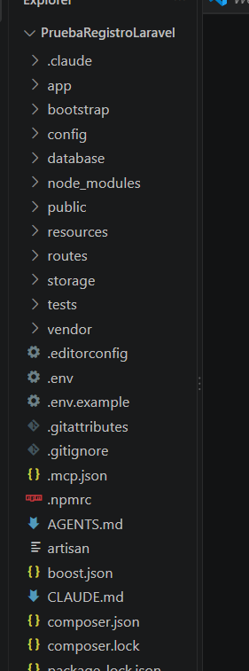

### 3.2 Dependencias y archivo `.env`

Si se clona el repositorio en otro equipo, se instalan las dependencias y se crea el `.env`:

```bash
composer install
copy .env.example .env
php artisan key:generate
npm install
```

### 3.3 Paquete de autenticación: `laravel/ui`

```bash
composer require laravel/ui
php artisan ui bootstrap --auth
npm install
composer run dev
```

| Comando | Función |
|---|---|
| `composer require laravel/ui` | Agrega el paquete oficial de scaffolding de autenticación. |
| `php artisan ui bootstrap --auth` | Genera Bootstrap más las vistas, controladores y rutas de login, registro y recuperación de contraseña. |
| `npm install` | Instala las dependencias de Node (Bootstrap, Vite, Sass, Axios). |
| `composer run dev` | Levanta a la vez el servidor de Laravel, la cola y Vite. |

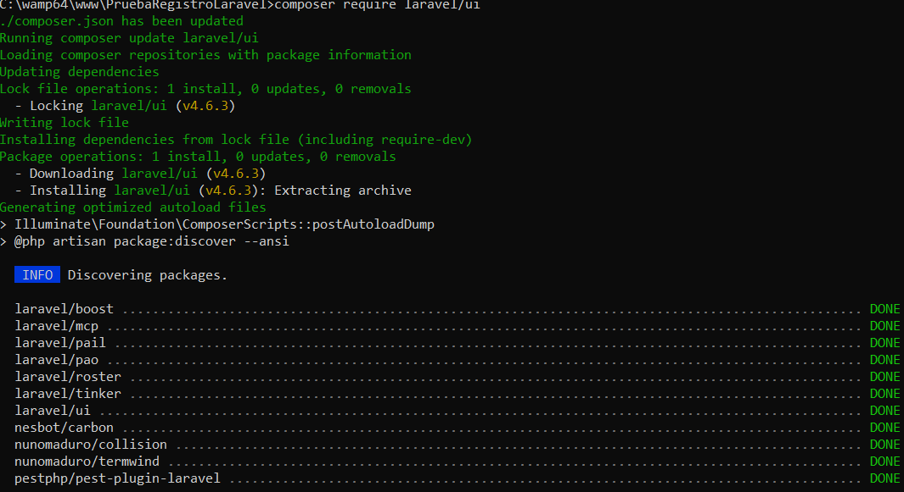

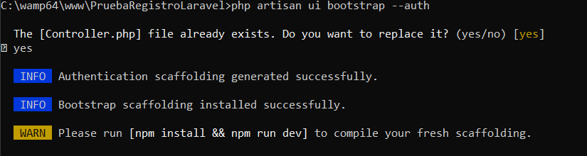

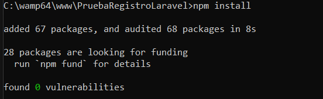

> **Alternativa documentada en la guía (no utilizada):** Laravel Breeze
> ```bash
> composer require laravel/breeze --dev
> php artisan breeze:install
> ```

---

## 4. 🗄️ Base de datos

### 4.1 Entorno

- **Motor:** MySQL 8.4.7 (InnoDB) administrado con phpMyAdmin.
- **Base de datos:** `pruebaregistrolaravel` (cotejamiento `utf8mb4_unicode_ci`).
- **Usuario:** `root` sin contraseña (configuración por defecto de WAMP).

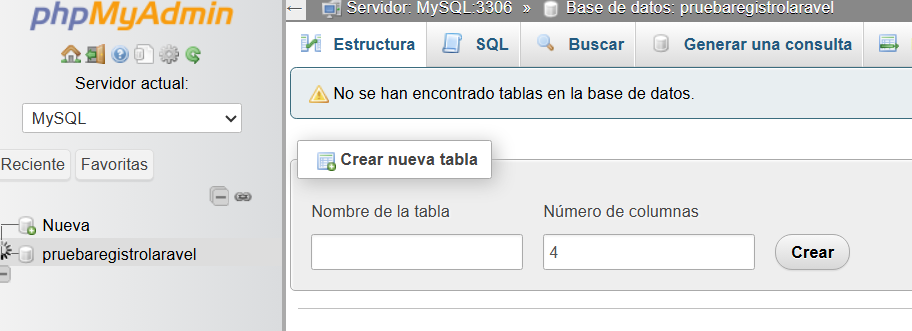

### 4.2 Configuración del `.env`

Laravel lee las credenciales de la base de datos desde el archivo `.env`:

```env
DB_CONNECTION=mysql
DB_HOST=127.0.0.1
DB_PORT=3306
DB_DATABASE=pruebaregistrolaravel
DB_USERNAME=root
DB_PASSWORD=
```

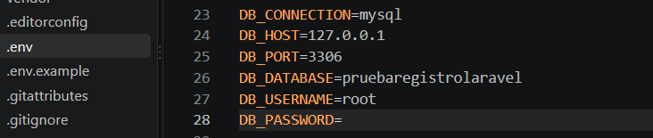

Después de editar el `.env` se limpia la caché de configuración para que Laravel lea los cambios:

```bash
php artisan config:clear
```

### 4.3 Migraciones

Las **migraciones** son archivos PHP en `database/migrations/` que describen cómo crear, modificar o eliminar tablas de forma controlada. El método `up()` crea la tabla y `down()` la revierte. Laravel guarda en la tabla `migrations` cuáles ya se ejecutaron para no repetirlas.

```bash
php artisan migrate
```

En este caso Laravel detectó que la base de datos no existía y ofreció crearla.

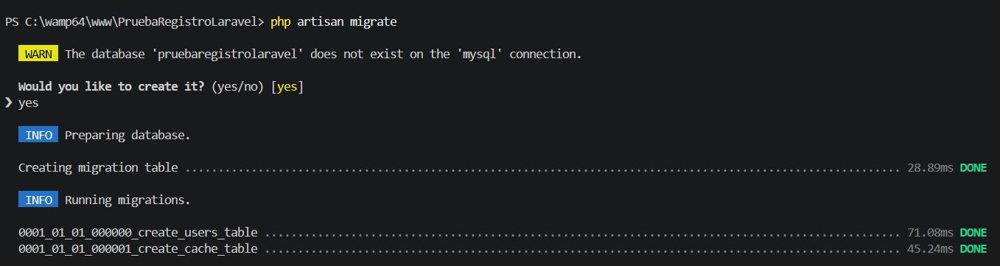

Tablas creadas (todas con motor **InnoDB**):

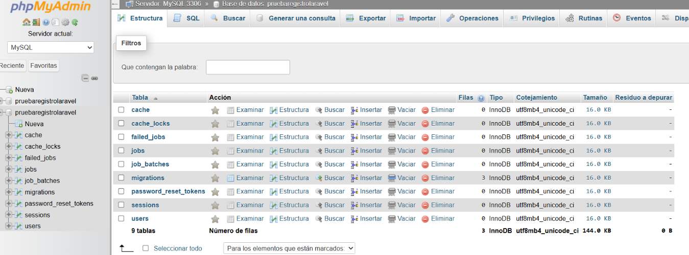

Otros comandos útiles de migraciones:

```bash
php artisan migrate:status     # ver qué migraciones se ejecutaron
php artisan migrate:rollback   # revertir la última tanda
```

### 4.4 Respaldo (backup) de la base de datos

El respaldo se encuentra en el repositorio: [`database/backup/pruebaregistrolaravel.sql`](database/backup/pruebaregistrolaravel.sql)

**Cómo se generó:**

- **Con phpMyAdmin:** seleccionar la base `pruebaregistrolaravel` → pestaña **Exportar** → método *Rápido*, formato *SQL* → **Exportar**.
- **Con la terminal:**
  ```bash
  C:\wamp64\bin\mysql\mysql8.4.7\bin\mysqldump.exe -u root --result-file=database/backup/pruebaregistrolaravel.sql pruebaregistrolaravel
  ```

**Cómo restaurarlo:** crear la base `pruebaregistrolaravel` en phpMyAdmin → pestaña **Importar** → seleccionar el archivo `.sql`.

---

## 5. ✅ Resultado del laboratorio

Con el servidor corriendo (`composer run dev`) el proyecto responde en `http://127.0.0.1:8000`.

**Página de bienvenida de Laravel:**

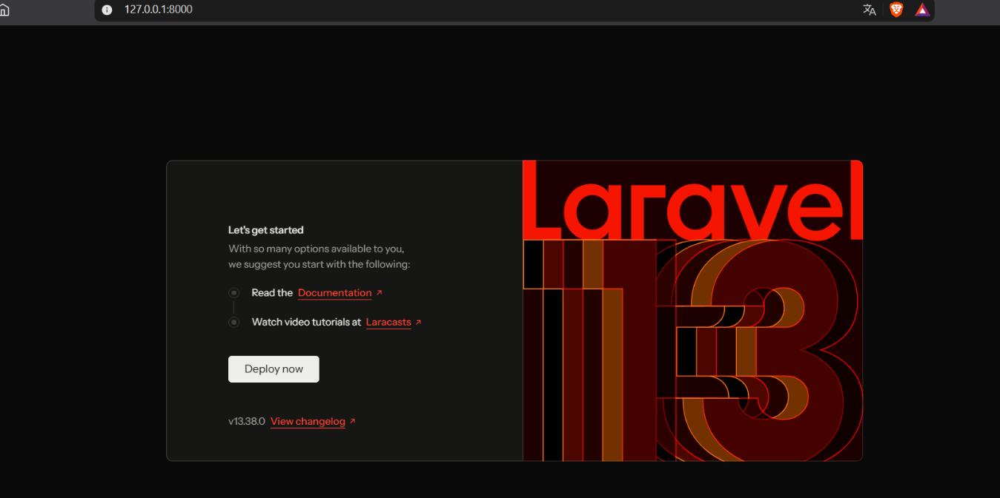

**Formulario de registro** (`/register`):

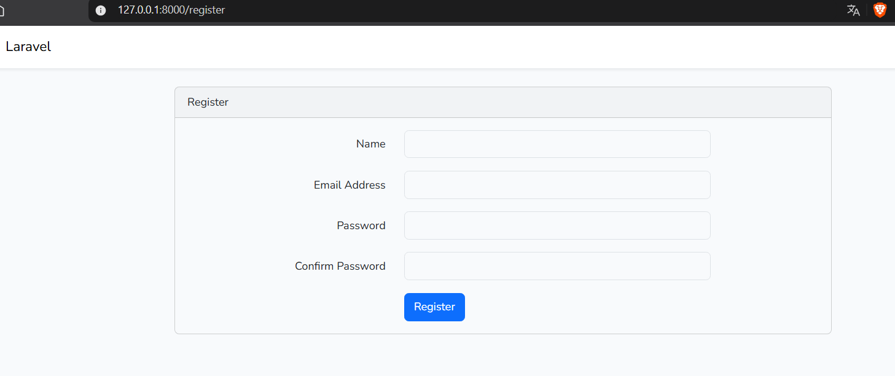

**Formulario de login** (`/login`):

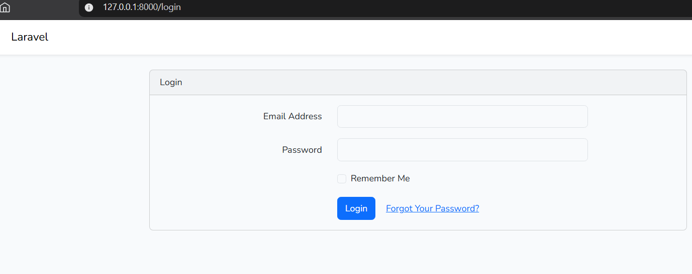

**Acceso exitoso** – tras registrarse, el usuario entra al panel `/home`:

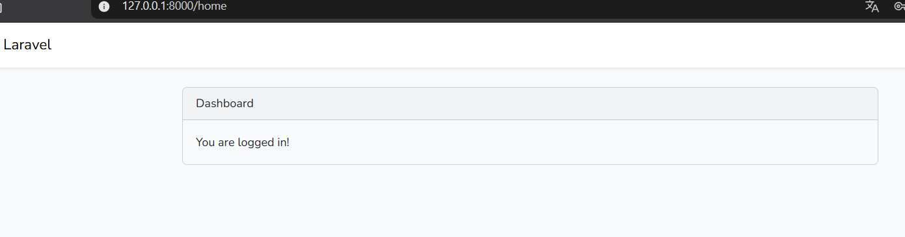

**Usuario guardado en la base de datos** – la contraseña se almacena encriptada (hash):

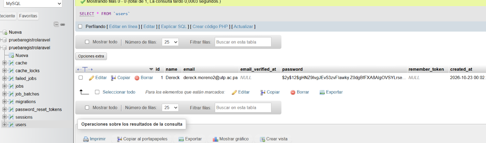

**Validación de credenciales incorrectas:**

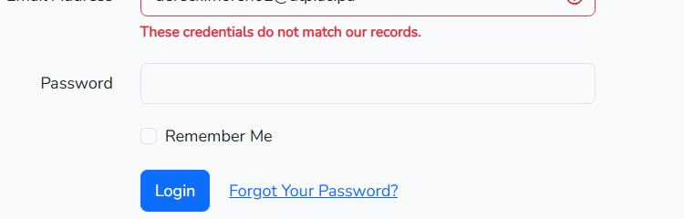

---

## 6. 🧩 Arquitectura MVC en el proyecto

Archivos del proyecto que corresponden a cada parte del patrón:

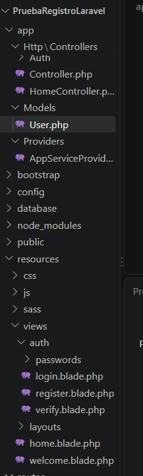

| Componente | Archivos |
|---|---|
| **Modelo** | `app/Models/User.php` |
| **Vistas** | `resources/views/auth/login.blade.php`, `register.blade.php`, `layouts/app.blade.php`, `home.blade.php` |
| **Controladores** | `app/Http/Controllers/Auth/LoginController.php`, `RegisterController.php`, `app/Http/Controllers/HomeController.php` |
| **Rutas** | `routes/web.php` |

Con `php artisan route:list` se ve cómo cada URL se conecta con su controlador (por ejemplo, `login` → `Auth\LoginController@showLoginForm` y `register` → `Auth\RegisterController@showRegistrationForm`):

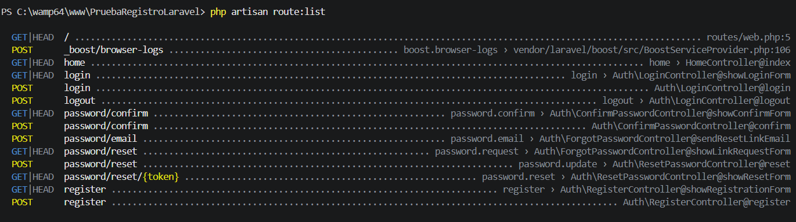

---

## 7. 🛠️ Dificultades y soluciones

Durante la ejecución del laboratorio se presentaron las siguientes complicaciones:

- **Dificultad 1: MySQL mostraba MyISAM como motor por defecto.**
  - **Solución:** se configuró `default-storage-engine=InnoDB` en el archivo `my.ini` de MySQL, se reinició WAMP y se verificó con `SHOW VARIABLES LIKE 'default_storage_engine';`.

- **Dificultad 2: PowerShell bloqueaba `npm` ("la ejecución de scripts está deshabilitada en este sistema").**
  - **Solución:** se habilitó la ejecución de scripts solo para el usuario actual con `Set-ExecutionPolicy -Scope CurrentUser -ExecutionPolicy RemoteSigned` (también es posible usar CMD).

- **Dificultad 3: el instalador `laravel new` mostraba preguntas adicionales (frontend stack y Laravel Boost) que no eran necesarias para el laboratorio.**
  - **Solución:** se eligió *Blade* como frontend stack y *no* usar starter kit, ya que el login se implementa con `laravel/ui`.

- **Dificultad 4: error `Command "ui" is not defined` al ejecutar `php artisan ui bootstrap --auth`.**
  - **Solución:** el paquete no estaba instalado correctamente. Se reinstaló con `composer require laravel/ui` y luego funcionó el comando.

- **Dificultad 5: error de Vite `Failed to resolve import "axios"` y el menú del usuario no respondía.**
  - **Solución:** `resources/js/bootstrap.js` importa `axios`, que no estaba instalado. Se resolvió con `npm install axios` y reiniciando `composer run dev`.

---

## 8. 📅 Fechas

- **Fecha de ejecución del laboratorio:** 22 de octubre de 2026
- **Fecha de entrega:** 22 de octubre de 2026

---

## 9. 📚 Referencias

1. Laravel. *Documentación oficial de Laravel*. https://laravel.com/docs
2. Laravel. *laravel/ui – Legacy scaffolding for Laravel* (repositorio oficial). https://github.com/laravel/ui
3. Composer. *Documentación de Composer*. https://getcomposer.org/doc/
4. Oracle. *MySQL Reference Manual – InnoDB Storage Engine*. https://dev.mysql.com/doc/refman/8.4/en/innodb-storage-engine.html
5. Bootstrap. *Documentación de Bootstrap 5.3*. https://getbootstrap.com/docs/5.3/
6. Fong, I. *Guía de Laboratorio: Cómo crear un Login y Registro en Laravel*. Universidad Tecnológica de Panamá.

---

<div align="center">

### 🎓 Información del estudiante

Este laboratorio ha sido desarrollado por el estudiante de la Universidad Tecnológica de Panamá:

**Nombre:** Dereck Moreno
**Correo:** dereck.moreno2@utp.ac.pa
**Curso:** 1S3122
**Instructor del Laboratorio:** Irina Fong

</div>
